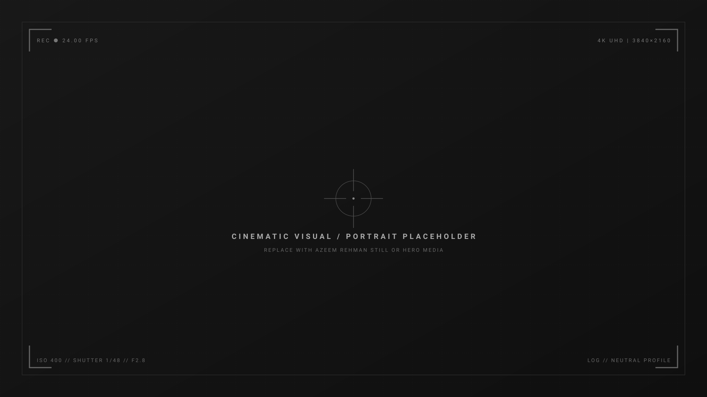
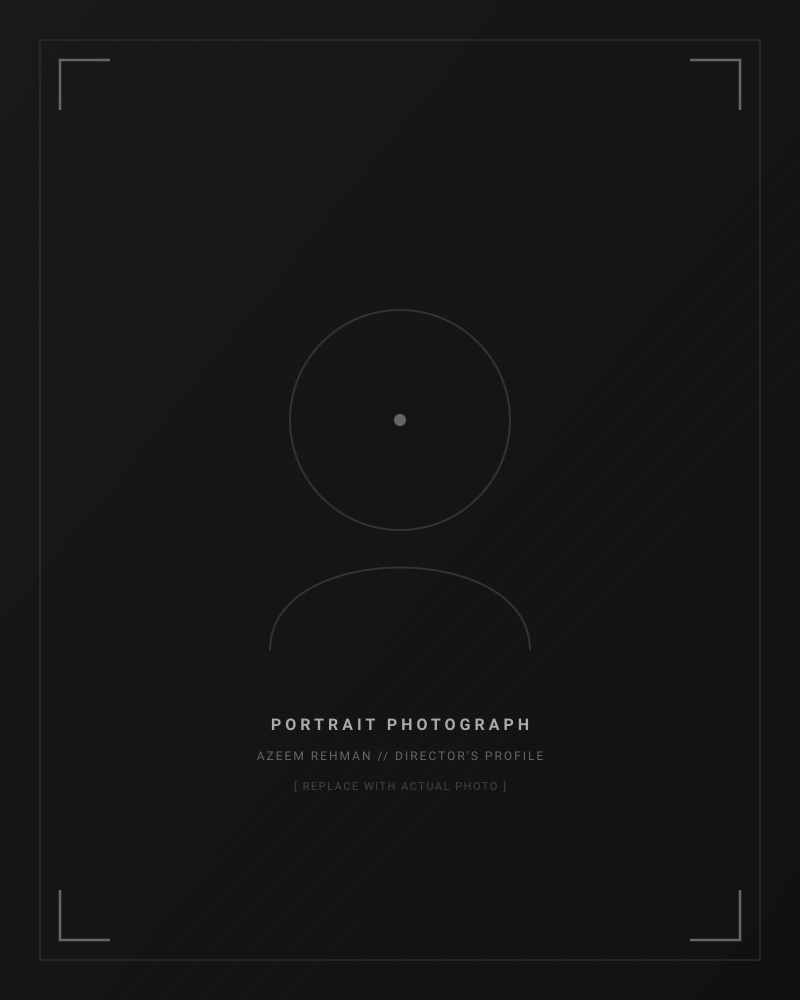

# Azeem Rehman — Portfolio Website

A clean, modern, responsive, and cinematic one-page portfolio website designed for **Azeem Rehman**, professional Videographer, Video Editor, and Video Direction Creative.

Built with **plain HTML5, CSS3, and vanilla JavaScript** — zero frameworks, zero external dependencies, lightweight, and structured for effortless editing in Visual Studio Code.

### 🎨 Cinematic Editorial Color Palette
- **Warm Ivory (`#EDE8DE`)**: Luminous headings, titles, and high-emphasis typography
- **Charcoal (`#242622`)**: Deep, organic cinematic background canvas
- **Muted Copper (`#A96E4C`)**: Metallic accents, primary CTAs, hover rings, and active states
- **Olive (`#777C69`)**: Camera telemetry, film tags, metadata, and status indicators
- **Sand (`#C7BFB1`)**: Editorial body copy, subtitles, and subtle divider accents

---

## 📁 Project Structure

```
azeem-portfolio/
│
├── index.html            # Main semantic HTML structure & content
├── style.css             # Cinematic editorial palette, animations & responsive styling
├── script.js             # Project data, YouTube video player, repeatable reveals & UI interactions
│
├── assets/               # Media & thumbnail directory
│   ├── hero-placeholder.svg      # Hero visual placeholder (16:9 cinematic aspect ratio)
│   ├── about-placeholder.svg     # About portrait placeholder (4:5 vertical aspect ratio)
│   ├── project-1.svg             # Project 01 thumbnail placeholder (LUXES Fashion Film)
│   ├── project-2.svg             # Project 02 thumbnail placeholder (LUXES Craftsmanship Film)
│   ├── project-3.svg             # Project 03 thumbnail placeholder (LYNX BY SWID Sports Campaign)
│   └── project-4.svg             # Project 04 thumbnail placeholder (Creative Video Project)
│
└── README.md             # Quick reference & editing instructions
```

---

## 🚀 How to Run the Website Locally

You can open and view this website immediately using any of these simple methods:

### Method 1: Direct File Open (Fastest)
1. In Windows File Explorer, navigate to:
   `C:\Users\Ahsan Arshad\Downloads\products\azeem-portfolio`
2. Double-click **`index.html`** to open it in your default browser (Chrome, Edge, Firefox, Brave, etc.).

### Method 2: Visual Studio Code with Live Server (Recommended)
1. Open the `azeem-portfolio` folder in **Visual Studio Code**.
2. If you have the **Live Server** extension installed:
   - Right-click `index.html` in the VS Code file explorer.
   - Select **"Open with Live Server"**.
   - Your browser will open at `http://127.0.0.1:5500` with live reload on file save.

### Method 3: Local Python or Node Server (Terminal)
If you prefer a lightweight local server:
- **Python**: Run `python -m http.server 3000` in terminal and visit `http://localhost:3000`.
- **Node**: Run `npx serve .` in terminal and visit `http://localhost:3000`.

---

## ✏️ Step-by-Step Customization Guide

All code is thoroughly organized and labeled with comments in English.

### 1. Adding YouTube Video Links
Open **`script.js`**. At the very top of the file, locate the **`PROJECTS_DATA`** array:

```javascript
const PROJECTS_DATA = [
  {
    id: "project-01",
    number: "01",
    title: "Fashion Film",
    brand: "LUXES",
    description: "A cinematic fashion film focused on visual storytelling, aesthetics and brand presentation.",
    contribution: "Videography, Video Direction & Video Editing",
    thumbnail: "assets/project-1.svg",
    youtubeUrl: "" // <-- PASTE YOUR YOUTUBE LINK HERE
  },
  ...
];
```

#### Supported YouTube URL Formats:
You can paste any standard or short YouTube link:
- Standard watch link: `https://www.youtube.com/watch?v=VIDEO_ID`
- Short link: `https://youtu.be/VIDEO_ID`
- Embed link: `https://www.youtube.com/embed/VIDEO_ID`
- Shorts link: `https://www.youtube.com/shorts/VIDEO_ID`

*Note: If you leave `youtubeUrl: ""` empty, the website automatically displays an elegant "Link Pending" state without breaking the layout.*

---

### 2. Replacing Placeholder Images with Real Photos

Place your image files (JPG, PNG, or WebP) inside the **`assets/`** folder:

1. **Hero Visual / Portrait**:
   - Save your image to `assets/` (e.g., `assets/hero-cinematic.jpg`).
   - Open **`index.html`** and locate line ~95:
     ```html
     
     ```
   - Change `src="assets/hero-placeholder.svg"` to `src="assets/hero-cinematic.jpg"`.

2. **About Section Portrait**:
   - Save Azeem's photo to `assets/` (e.g., `assets/azeem-portrait.jpg`).
   - Open **`index.html`** and locate line ~140:
     ```html
     
     ```
   - Change `src="assets/about-placeholder.svg"` to `src="assets/azeem-portrait.jpg"`.

3. **Project Thumbnails**:
   - Save project cover images to `assets/` (e.g., `assets/luxes-fashion.jpg`).
   - Open **`script.js`** and update the `thumbnail` property in `PROJECTS_DATA`:
     ```javascript
     thumbnail: "assets/luxes-fashion.jpg",
     ```

---

### 3. Updating Contact Information

You can update contact details in **`script.js`** (lines ~45-51):

```javascript
const CONTACT_INFO = {
  email: "contact@azeemrehman.com",
  instagramHandle: "@azeemrehman",
  instagramUrl: "https://instagram.com/azeemrehman",
  linkedinHandle: "linkedin.com/in/azeemrehman",
  linkedinUrl: "https://linkedin.com/in/azeemrehman"
};
```
These values will automatically populate the Contact section and social links. You can also edit them directly in **`index.html`** inside the `#contact` section.

---

### 4. Editing Project Descriptions & Contributions

All project copy can be edited directly inside the `PROJECTS_DATA` array in **`script.js`**:
- `title`: The film or campaign title.
- `brand`: The client or studio name.
- `description`: The short summary.
- `contribution`: Azeem's exact role (e.g. *Videography, Video Direction & Video Editing*).
